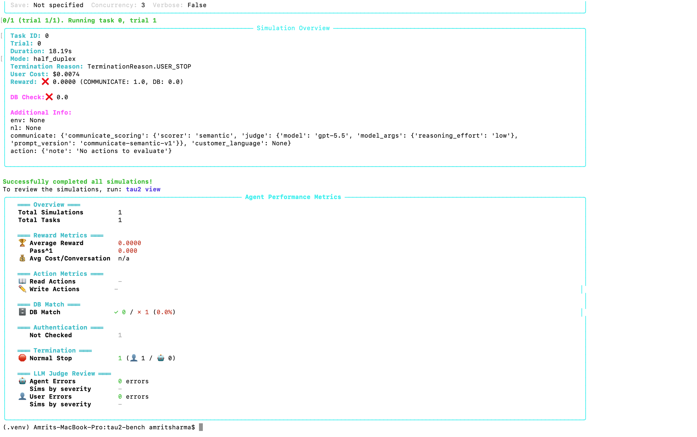
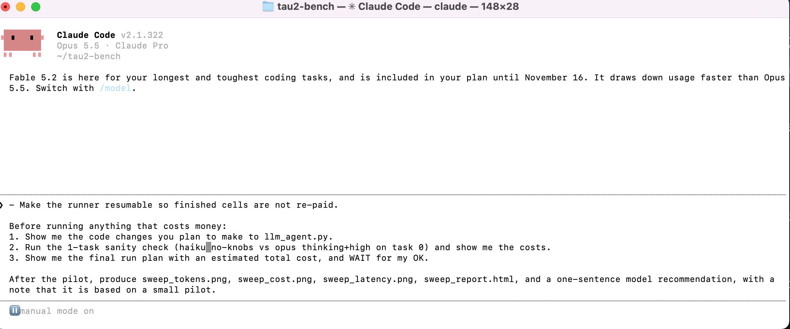
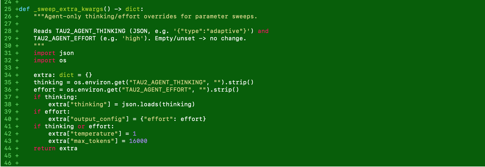
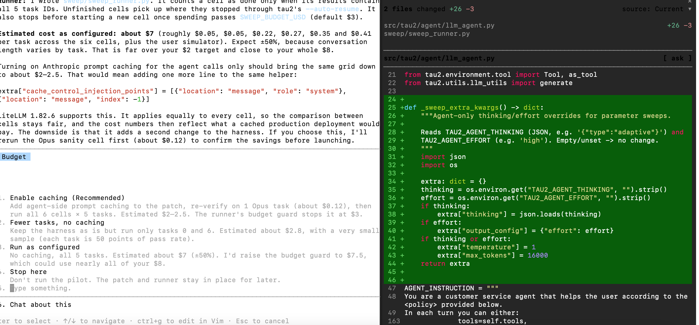
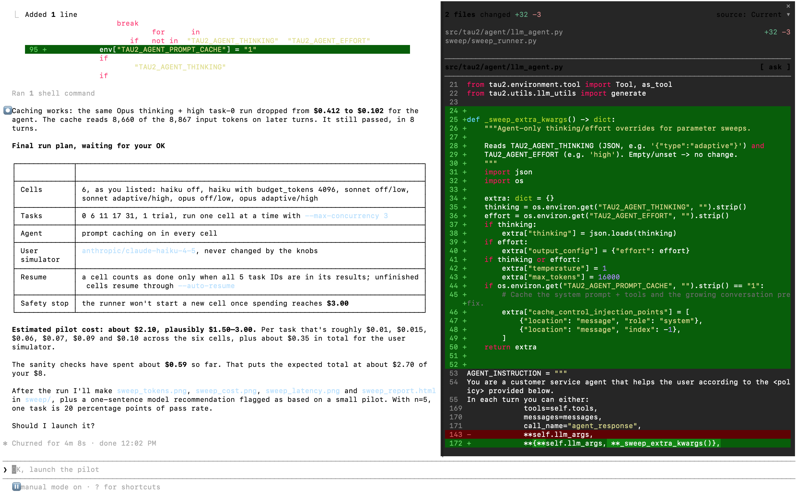
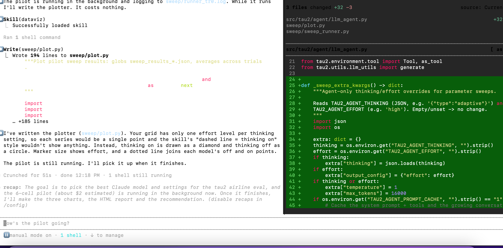
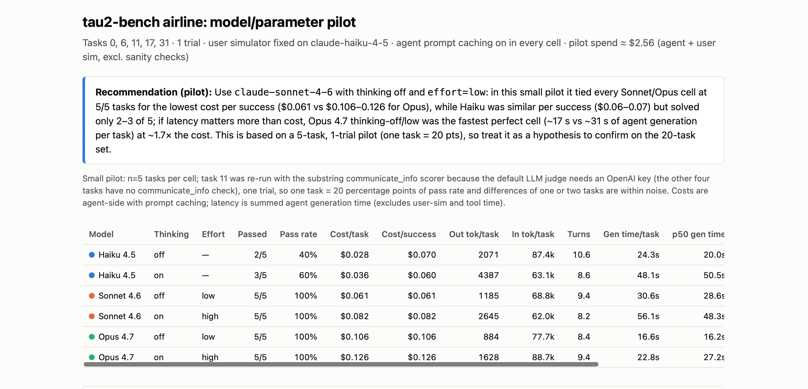
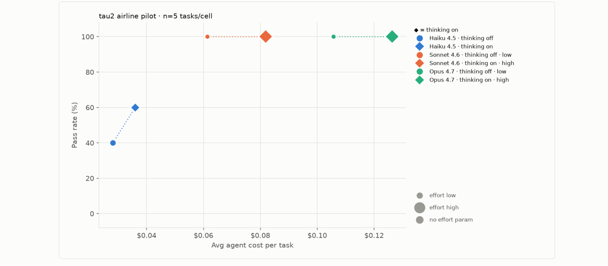

# Build Log

A short record of how I completed this project on **November 11, 2026**, following Anthropic's "Picking the Right Model" workshop video. Each section covers what I did, what I learned, and any problem I solved along the way.

---

## 1. Understanding the goal

**What I did:** Watched the workshop video and read the workshop's guide.

**What I learned:** The workshop teaches a way to choose an AI model with data instead of guessing. You run the same test across different models and settings, then compare quality, cost, and speed. The test used here is **tau2-bench**, where an AI agent handles airline customer requests using tools, and a second AI plays the customer.

---

## 2. Setting up the test

**What I did:** Downloaded tau2-bench, created a separate Python environment for it, installed it, and stored my API key in a local settings file.

**What I learned:**
- A separate Python environment keeps one project's packages from clashing with another's.
- The setup guide warned about a known issue with Python 3.13, so I installed the fix before it could cause errors. Reading setup docs carefully saves time later.

**Problem solved:** My API key was accidentally exposed while I was setting it up. I deleted that key right away, created a new one, and saved it using hidden input so it never appeared on screen again. **Lesson:** treat any exposed key as compromised and replace it.

*A one-task test confirmed the setup worked before I spent real money.*

---

## 3. Planning within a budget

**What I did:** Before running anything large, I estimated the cost of the full workshop plan.

**What I learned:** The full plan (14 setups × 20 tasks × 3 runs) would have cost about $40–60, which was more than my $8 budget. I designed a smaller pilot that still compared all three models at their lowest and highest settings: **6 setups × 5 tasks × 1 run**.

*My instructions to Claude Code: a budget limit, a smaller test, never show the API key, and wait for my approval before spending money.*

---

## 4. Working with Claude Code

**What I did:** Used Claude Code to update the test so it could switch "thinking" and "effort" on and off. I kept it in manual mode, so every file change and paid run needed my approval.

**What I learned:**
- How to read a code change before approving it. The change added a small helper that passes thinking and effort settings to the model and changes nothing when they are off.
- When to let an AI assistant act on its own and when to keep a person in the loop. Reading files is low risk. Spending money is not.

---

## 5. Controlling cost

**What I did:** Claude Code ran one task on each model as a cost check. Real costs were about four times higher than the workshop guide estimated, putting the pilot at about $7.

**What I learned:** **Prompt caching** lets the model reuse the long instructions it receives on every turn. I turned it on for every setup, so the comparison stayed fair. It cut the cost of an Opus task from $0.41 to $0.10, and the task still passed. The pilot estimate dropped to about $2.

---

## 6. Running the pilot

**What I did:** Approved the run and checked progress with a read-only command while it ran in the background.

**Problem solved:** One task (task 11) failed in every setup. The cause was the test, not the models: that task's grader used an outside AI service I hadn't set up. I re-ran it with a simpler built-in grader, which cost about $0.40.

**What I learned:** Before trusting results, check that the test itself works. This is the "audit" step the workshop recommends.

---

## 7. Results

**What I found:**
- **Sonnet 4.6, thinking off** solved all 5 tasks at the lowest cost per success ($0.061). This is my recommendation.
- **Opus 4.7, thinking off** also solved everything and was the fastest, but cost about 70% more.
- **Haiku 4.5** was the cheapest per task but solved only 2–3 of 5.
- **Thinking** helped Haiku but did not improve Sonnet or Opus on these tasks. It only added cost and time.

**What I learned:** With only 5 tasks, one task equals 20 percentage points. These results point in a direction but are not final. A larger run would be needed to confirm them.

---

## Skills I practiced

- Setting up and running an open-source AI benchmark
- Understanding how AI agents use tools to complete tasks
- Comparing models on quality, cost, and speed
- Estimating costs and scoping an experiment to a budget
- Handling API keys safely
- Directing an AI coding assistant with clear limits and reviewing its work
- Reading charts and explaining results in plain language

## How I can use this

- **Product work:** choosing which AI model to use in a feature, based on quality, cost, and speed.
- **Analytics work:** designing small, fair experiments and presenting results with their limits.
- **Technical work:** setting up test environments, managing secrets, and working with AI coding tools.

---

*Based on Anthropic's "Picking the Right Model" workshop and Sierra's tau2-bench. See the README for full credits.*
