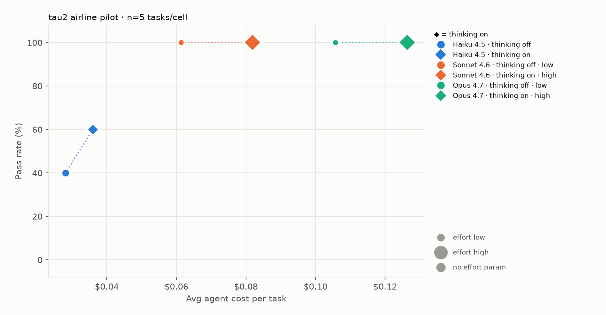
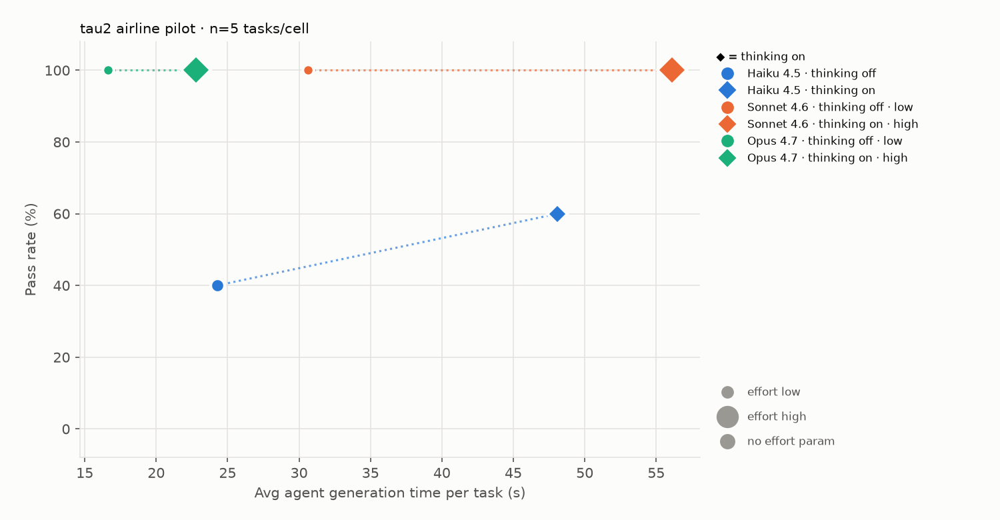
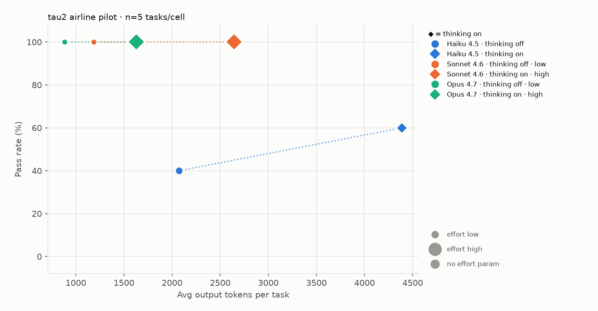

# Picking the Right Claude Model: A Hands-On Learning Project

I followed Anthropic's **"Picking the Right Model"** workshop video and ran its main exercise myself. I tested three Claude models on customer-service tasks for a simulated airline and compared them on **quality, cost, and speed**. The goal was to answer a practical question: *which model should I use for this job, and why?*

**My recommendation from the test:** use **Claude Sonnet 4.6 with thinking off**. It solved every task at the lowest cost per success. If speed matters more than cost, Claude Opus 4.7 with thinking off was the fastest.

---

## Why I did this

I want to understand how AI agents work, how to test them fairly, and how to choose the right model for a task. I learned by watching the workshop and doing each step on my own computer. When something didn't work as expected, I stopped, figured out why, and fixed it before moving on.

---

## What I learned

**1. How an AI agent works**
An agent is an AI model that is given instructions, talks with a user, and uses tools to get a job done. In this project, the agent acted as an airline support agent. It could look up bookings, change flights, and issue refunds. A second AI played the customer.

**2. How to test an agent**
I used **tau2-bench**, an open-source test from Sierra. Each task has a goal, like "change this customer's flight." At the end, the test checks whether the airline's records were updated correctly. That gives a clear pass or fail.

**3. Bigger is not always better**
The largest model (Opus) did not beat the mid-size model (Sonnet) on these tasks. Both solved everything, but Sonnet cost about 40% less. The right model depends on the task, the budget, and how fast the answer needs to be.

**4. "Thinking" helps some models more than others**
Claude models can be set to think before they answer. Turning thinking on helped the smallest model (Haiku went from 40% to 60%). For Sonnet and Opus, it added cost and time but no extra correct answers, because they were already solving every task.

**5. Check costs on a small test first**
Before the main run, I tested one task on each model. Costs were higher than the workshop guide expected. I turned on **prompt caching**, which lets the model reuse the long instructions it receives on every turn instead of paying for them each time. This cut costs by about 75%.

**6. Check the test itself, not just the models**
One task failed in every setup. The cause was the test, not the models: that task used an outside AI service to grade the answer, and I didn't have access to it. I re-ran the task with a simpler grader. The lesson is to make sure the test works before trusting its results.

**7. Working with an AI coding assistant**
I used **Claude Code** to edit code and run the test. I gave it clear limits (budget, task count, never show my API key), reviewed each code change before approving it, and required it to show me a cost estimate and wait for my OK before spending money.

---

## What I did

1. Installed the test (tau2-bench) in its own Python environment and ran a one-task test to confirm everything worked.
2. Stored my API key safely in a local settings file that is never shared or uploaded.
3. Used Claude Code with the workshop's instructions to add "thinking" and "effort" settings to the test.
4. Scaled the experiment to fit my budget. The full workshop plan would have cost about $40–60, so I designed a smaller pilot: **6 model setups × 5 tasks**.
5. Ran the pilot, fixed the one broken task, and created charts and a report.

**Total cost: about $3.**

---

## Results

| Model | Thinking | Effort | Tasks passed | Cost per task | Time per task |
|---|---|---|---|---|---|
| Haiku 4.5 | off | — | 2 of 5 | $0.028 | 24s |
| Haiku 4.5 | on | — | 3 of 5 | $0.036 | 48s |
| **Sonnet 4.6** | **off** | **low** | **5 of 5** | **$0.061** | **31s** |
| Sonnet 4.6 | on | high | 5 of 5 | $0.082 | 56s |
| Opus 4.7 | off | low | 5 of 5 | $0.106 | 17s |
| Opus 4.7 | on | high | 5 of 5 | $0.126 | 23s |

*Prompt caching was on for every setup. "Time" is how long the agent spent writing its replies.*

### How to read the charts

- **Higher is better** (more tasks passed).
- **Further left is better** (cheaper, faster, or shorter).
- Color is the model. A circle means thinking off; a diamond means thinking on. The dotted line shows the change when thinking is turned on.

**Pass rate vs. cost**: Sonnet with thinking off is the furthest-left point at the top.


**Pass rate vs. speed**: Opus with thinking off is the fastest model to solve every task.


**Pass rate vs. output length**: the stronger models wrote less and solved more.


The full report is in [`charts/sweep_report.html`](charts/sweep_report.html). Download it and open it in a browser.

### Limits of this test

This was a small pilot: 5 tasks, run once each. One task equals 20 percentage points, so the results show a direction, not a final answer. The next step would be to run the workshop's full 20-task set several times to confirm the recommendation.

---

## What I would do next

- Run the full 20-task set with 3 runs each to confirm the result.
- Add the middle effort settings to see where quality starts to drop.
- Try the same method on a different kind of task, like a retail support agent.

---

## Tools used

- **Claude Code**: AI coding assistant that edited code and ran the test under my review
- **tau2-bench**: open-source benchmark for testing AI agents
- **Python 3.13**, **matplotlib** (charts), **Terminal** on macOS
- **Claude API**: Haiku 4.5, Sonnet 4.6, and Opus 4.7

---

## Repository contents

```
README.md        This overview
BUILD_LOG.md     A short log of the key steps, problems, and lessons
charts/          The three charts and the full HTML report
code/            The scripts that ran the test and drew the charts, plus the change made to tau2-bench
results/         The raw results and the final recommendation
screenshots/     Screenshots from each stage of the project
```

---

## Credits

This project is a learning exercise based on other people's work. All credit for the method and tools goes to them.

- **Workshop video:** Anthropic, "Picking the Right Model" workshop (Code with Claude). https://www.youtube.com/watch?v=P0uMXS6emHA
- **Workshop materials and Claude Code skill:** Anthropic, `cwc-workshops/rightmodel`. https://github.com/anthropics/cwc-workshops/tree/main/rightmodel (Apache-2.0 license)
- **Benchmark:** Sierra, `tau2-bench`. https://github.com/sierra-research/tau2-bench (see the repository for its license)
- **Claude Code** and the **Claude API** by Anthropic

The scripts in code/ were written by Claude Code under my review. llm_agent_patch.diff shows the only change made to my local copy of tau2-bench; the rest of tau2-bench is not included here.
